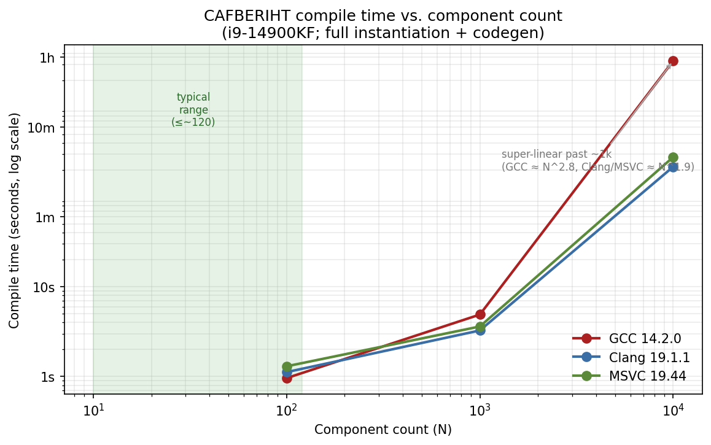

# CAFBERIHT: A Low-Boilerplate Pattern for Zero-Overhead Heterogeneous Collections in C++

**A filtered, tag-dispatched aggregate over heterogeneous types, with per-component boilerplate reduced to a single inheritance line**

**Date**: December 2025 (revised)
**Author**: Nihilai Collective Corp

---

## What this is, in one paragraph

CAFBERIHT is a C++20/23 pattern for holding a fixed set of different types in one object, iterating over them, applying operations only to the subset that supports them, and accessing any of them by index or enum, all resolved at compile time, with no virtual dispatch, no type erasure, and no function-pointer indirection. None of the underlying techniques are new: it is built from CRTP, variadic multiple inheritance, pack `using`-declarations, fold expressions, and `if constexpr` filtering, all of which are well established. The contribution is the specific combination, plus a CRTP base (`core_elem_base`) that collapses what would otherwise be four `operator[]` overloads per component into a single inheritance line. This document explains the pattern, states precisely what it does and does not guarantee, and backs the performance claims with compiler-emitted assembly rather than assertion.

---

## The problem

Sometimes you need to hold a collection of related-but-different types (a transformer's tensor operations, a game entity's components, a set of plugins) and operate over them uniformly without giving up their distinct types or paying for runtime polymorphism. The usual options each involve a trade-off:

- **`std::variant` / type erasure (`std::any`, `void*`)**: gives you runtime indexing and heterogeneous visitation, but adds a runtime discriminator/dispatch and, for `any`, loses static type information. This is the right tool when the active type genuinely isn't known until runtime.
- **Virtual hierarchy**: clean and extensible, but every object carries a vtable pointer, every call is an indirect jump, and all types are forced through one base interface. The right tool when you need open-ended runtime extensibility (e.g. plugins loaded from a DSO).
- **`std::tuple`**: zero-overhead and fully typed, but applying an operation across the elements requires every element to support it (`std::apply` / fold over `std::get`), and access is positional (`std::get<I>`) rather than semantic. The closest standard-library analogue to what CAFBERIHT does.
- **Type-list libraries (Boost.Mp11, Brigand)**: powerful compile-time manipulation, but oriented toward type computation rather than holding runtime state with ergonomic runtime access.

CAFBERIHT occupies the same niche as `std::tuple`, with two differences that matter for some workloads: operations can be **filtered** so that only matching components are touched (the others generate no code), and components are addressable by a **semantic enum** rather than a positional index. The cost is that the set of types is fixed at compile time; if you need runtime-variable membership, this is the wrong tool and a `variant` or virtual approach is better.

This is a trade-off, not a verdict. The alternatives above are not "fatal flaws"; they are different points on the same design space. If your type set is fixed and known, CAFBERIHT lets you keep full type information and skip runtime dispatch. If it isn't, don't use it.

---

## The core idea

### The CRTP base

The ergonomic centre of the pattern is a CRTP base that gives each component a tag-dispatched `operator[]`:

```cpp
template<auto index> using tag = std::integral_constant<uint64_t, static_cast<uint64_t>(index)>;

template<auto index, typename derived_type>
struct core_elem_base {
    constexpr decltype(auto) operator[](tag<index>) &       noexcept { return *static_cast<derived_type*>(this); }
    constexpr decltype(auto) operator[](tag<index>) const&  noexcept { return *static_cast<const derived_type*>(this); }
};
```

A component opts in with one line of inheritance:

```cpp
template<auto enum_value_new>
struct core_interface : core_elem_base<enum_value_new, core_interface<enum_value_new>> {
    uint64_t kernel_iteration_count{};
    static constexpr core_types enum_value{ enum_value_new };
};
```

Without the CRTP base, each component would hand-write the `operator[]` overloads itself. For a collection of N components that is N boilerplate blocks instead of N inheritance lines. The reduction is real and it is the practical reason the pattern is usable; it is not, by itself, a novel language technique: CRTP for static dispatch is decades old. (The implementation shown provides the lvalue and const-lvalue overloads. If you need correct forwarding of rvalue access, add the `&&` / `const&&` overloads; they follow the same shape.)

### The aggregate

The collection inherits from all its components and merges their `operator[]` overloads into one overload set:

```cpp
template<typename... bases>
struct cafberiht : public bases... {
    using bases::operator[]...;
    static constexpr uint64_t size{ sizeof...(bases) };
    // ...
};
```

Because each `core_elem_base<index, Derived>` is keyed on *both* the index and the derived type, two components can never share a base subobject. A consequence worth stating precisely (see "Structural invariants" below): diamond inheritance cannot be formed in this hierarchy.

### Filtered dispatch

Operations are expressed as mixins with a compile-time `filter()` and an `impl()`:

```cpp
template<typename base_type>
struct addition_mixin {
    static consteval bool filter() { return (static_cast<uint64_t>(base_type::enum_value) % 2) == 0; }
    static void impl(base_type&, volatile uint64_t& out) { out += rand(); }
};
```

Applying a mixin folds over the bases, guarding each call with `if constexpr`:

```cpp
template<template<typename> typename mixin_type, typename... arg_types>
constexpr void impl(arg_types&&... args) noexcept {
    (impl_internal_filtered<mixin_type, bases>(args...), ...);
}

template<template<typename> typename mixin_type, typename base_type, typename... arg_types>
constexpr void impl_internal_filtered(arg_types&&... args) noexcept {
    if constexpr (mixin_type<base_type>::filter()) {
        mixin_type<base_type>::impl(*this, args...);
    }
}
```

Components whose `filter()` is `false` are excluded by `if constexpr`, so no code is generated for them. Components that match expand into a flat sequence of direct calls. This is the one capability that distinguishes the pattern from a plain tuple: **partial interfaces**: you can apply an operation to only the components that support it, without requiring a common interface and without a runtime check to skip the rest.

---

## Performance: measured, not asserted

The claim is narrow and testable: **under optimizing compilation, code using CAFBERIHT produces the same machine code as the equivalent hand-written sequence of direct calls.** Everything below was verified on the toolchain named; we do not claim results for toolchains we did not run.

### Method

A `cafberiht` of 10 components (`core_interface<core_types::a..j>`) has a mixin applied that keeps even-indexed components (5 of 10) and does `out += rand()` into a `volatile` accumulator (the `volatile` prevents the optimizer from folding the calls away, so they survive as observable work). We compare its `main` against a hand-written baseline: ten plain structs, one inherited aggregate, and five literal `out += rand();` statements. Both compiled with `g++ -std=c++23`.

### Result

At `-O2`, the body of `main` is **instruction-for-instruction identical** between the two. Normalizing only the compiler-internal function-label number, `diff` reports no differences; both `main` bodies contain 74 lines of assembly. The dispatch portion is exactly:

```asm
call    rand@PLT
call    rand@PLT
call    rand@PLT
call    rand@PLT
call    rand@PLT
```

Five direct calls, no loop, no indirect branch, no vtable load. The five odd-indexed components produced zero instructions. (The remaining calls in `main` are `iostream` work for the final `std::cout` line, identical in both versions; the single `call *%rax` is locale widening from `operator<<`, not pattern dispatch.)

### Across optimization levels

| `-O` level | CAFBERIHT `main` insns | Hand-written `main` insns |
|---|---|---|
| `-O0` | 43 | 70 |
| `-O1` | 41 | 41 |
| `-O2` | 64 | 64 |
| `-O3` | 64 | 64 |

The equivalence holds at `-O1` and above. At `-O0` the two differ (and CAFBERIHT is actually *fewer* instructions, because the baseline's repeated `volatile` accesses aren't coalesced); `-O0` is not a meaningful comparison point because nothing is inlined on either side. This matches the intended deployment condition: release builds at `-O1`+ (the pattern's `always_inline` helpers and `if constexpr` elimination depend on the optimizer running).

### Scope of the performance claim

- **Verified on**: GCC 13.3.0, x86-64, `-std=c++23`, `-O1` through `-O3`.
- **Not verified by us**: Clang and MSVC. The pattern uses only standard C++20/23 features and there is no obvious reason it would behave differently, but we have not run those compilers and therefore do not claim specific results for them. If you intend to ship on Clang or MSVC, reproduce the diff there; the test is small and included.
- **What "zero overhead" means here**: zero overhead *for the dispatch and access machinery*, relative to writing the same calls by hand, under the conditions above. It does not mean the operations themselves are free, and it says nothing about end-to-end throughput of any larger program, which depends entirely on what the mixins actually do.

### Reproduce it

```bash
g++ -std=c++23 -O2 -DCAFBERIHT_WIDTH=10 example.cpp -S -o example.s
g++ -std=c++23 -O2 baseline.cpp           -S -o baseline.s
# compare the main bodies
diff <(awk '/^main:/{f=1} f; /\.cfi_endproc/{if(f)exit}' example.s) \
     <(awk '/^main:/{f=1} f; /\.cfi_endproc/{if(f)exit}' baseline.s)
```

---

## Compile-time scaling

The performance section above concerns *runtime* code. The pattern's other cost is *compile* time, and it is worth being precise about it because it is the pattern's main practical limit.

The following figures were **measured by the authors** on an Intel Core i9-14900KF (full template instantiation plus codegen, single translation unit). Unlike the runtime assembly above, which we reproduced directly, these are reported measurements on the authors' hardware; treat them as such and reproduce on your own setup if the numbers matter to your build.

| Compiler | N = 100 | N = 1,000 | N = 10,000 |
|---|---|---|---|
| GCC 14.2.0 (WSL/Linux x64) | 0.96 s | 4.90 s | 54 m 38 s |
| Clang 19.1.1 (WSL/Linux x64) | 1.12 s | 3.26 s | 3 m 37 s |
| MSVC 19.44.35222 (Windows x64) | 1.30 s | 3.61 s | 4 m 38 s |



Two things to read off this:

**In the intended range, compile time is a non-issue.** At N = 100 every compiler is at roughly one second. Heterogeneous collections of this kind (a transformer's operation set, a game entity's components, a plugin set) are realistically in the tens to low hundreds of components (the largest transformer operation set we have worked with is around 120). Across that whole range the cost is flat: below ~1,000 components the measured scaling is actually *sub*-linear (apparent exponent ~0.4–0.7), because fixed compiler startup dominates the work.

**Past ~1,000 components it degrades sharply, and you should not go there.** Between 1,000 and 10,000 the scaling turns strongly super-linear: Clang and MSVC land near quadratic (apparent exponent ~1.8–1.9), and GCC is markedly worse (~2.8, i.e. roughly cubic), blowing up to nearly an hour at 10,000. The likely mechanism is the `using bases::operator[]...;` overload set: merging N tag-dispatched `operator[]` declarations into one set and resolving against it is a known super-linear cost centre in current compilers, and GCC evidently handles it least gracefully at scale.

The practical guidance follows directly: **this pattern is for collections of up to a few hundred components.** That covers its intended uses comfortably. If you find yourself wanting thousands of distinct compile-time components in one aggregate, the overload-set cost makes this the wrong representation; partition into smaller aggregates, or use a data-driven runtime structure instead. The 10,000-component figures are included not as a recommendation but as a stress test that locates the ceiling.

---

## Structural invariants

These are properties enforced by the type system, stated as facts about the construction rather than as theorems.

**Index uniqueness.** Two components sharing the same `tag<index>` make `operator[](tag<index>)` ambiguous, which is a compile error. Indices must be distinct.

**No shared base subobject.** `core_elem_base<i, A>` and `core_elem_base<i, B>` are different types whenever `A` and `B` differ, because the base is parameterized on the derived type as well as the index. No two components can therefore share a base subobject.

**Diamond inheritance is unrepresentable.** A diamond requires a common base reachable by two paths. Since no two components share a base subobject, the inheritance graph has no such common base, so the classic multiple-inheritance hazards (duplicate subobjects, ambiguous base lookup, virtual-base requirements) cannot arise in this hierarchy. This is a structural consequence, not a coding convention.

**Memory layout.** The aggregate's layout is standard multiple inheritance with empty-base optimization applied to each `core_elem_base`. We verified EBO directly: a 10-component aggregate where each component holds one `uint64_t` has `sizeof == 80` (`10 * sizeof(uint64_t)`), i.e. the CRTP bases contribute zero bytes, confirmed by `static_assert(sizeof(C) == 10 * sizeof(uint64_t))` compiling cleanly on GCC 13.3. Note that the C++ standard does not mandate a specific MI layout, so exact byte arrangement is implementation-defined; what we claim is that the CRTP base adds no size beyond the components' own data, which is what EBO guarantees and what we measured.

**Compile-time bounds checking.** Out-of-range index access is rejected at compile time. `get_core_by_index<2223>()` on a 10-wide aggregate fails to compile, and because the error path encodes the index into an undefined template name, the diagnostic names the offending value:

```
error: incomplete type 'static_assert_printer_impl<
        cafberiht_errors::get_core_by_index_oob,
        error_printer_val_inserter<2223> >' used in nested name specifier
```

The `2223` is visible in the error, so the fix doesn't require a separate debugging pass. (Verified on GCC 13.3.)

---

## How it compares

| Approach | Static typing | Dispatch cost | Heterogeneous ops | Runtime/semantic access | Per-item boilerplate | Membership |
|---|---|---|---|---|---|---|
| **CAFBERIHT** | Full, compile-time | None (verified, see scope) | Yes, with filtering | Index + enum | One inheritance line | Fixed at compile time |
| `std::tuple` | Full, compile-time | None | All elements must support the op | Positional `get<I>` | None | Fixed at compile time |
| `std::variant` | Active type checked at runtime | Visitation/dispatch | Yes, via `visit` | Yes | Low | One-of-set, runtime |
| Virtual hierarchy | Type-erased to base | vtable + indirect call | Common interface only | Yes | Low | Open, runtime |
| Boost.Mp11 / Brigand | Full, compile-time | None | Type-level | Not designed for runtime state | Varies | Fixed at compile time |

The honest one-liners:

- **vs `std::tuple`**: CAFBERIHT adds filtered application (operate on a subset without a common interface or a runtime skip) and enum-based semantic access. If you don't need either, a tuple is simpler and you should use it.
- **vs `std::variant`**: different problem. `variant` is for one-of-a-set chosen at runtime; CAFBERIHT holds all components at once with no runtime discriminator. Use `variant` when membership is dynamic.
- **vs virtual hierarchy**: CAFBERIHT trades runtime extensibility for the elimination of vtable overhead. If you need to load types at runtime, use virtual dispatch.
- **vs Mp11/Brigand**: those are type-computation toolkits; CAFBERIHT is a runtime-usable container that happens to resolve its structure at compile time. They solve adjacent, not competing, problems.

We are not aware of a standard-library or widely-used type that bundles compile-time filtered dispatch, enum-based access, and fixed heterogeneous membership in exactly this form, which is the sense in which the *combination* is the contribution. We make no claim that any individual ingredient is original.

---

## Worked applications

The pattern is domain-agnostic. Three sketches; each component is one inheritance line plus its data, and each operation is one mixin.

**Entity-component (game):** components `Transform`, `Render`, `Physics`, `AI`, each `core_elem_base<N, …>`. An `update_mixin` whose `filter()` is `requires(base& b, float dt){ b.update(dt); }` calls `update` only on components that have it. Components with no `update` generate no code in that pass.

**Plugin set (fixed at build time):** `Audio`, `Video`, `Network` plugins; an `init_mixin` initializes whichever expose `init()`. Note "fixed at build time": for plugins loaded from disk at runtime this is the wrong tool; use a virtual interface.

**Resource accounting:** `Texture`, `Buffer`, `Shader`, each tagged with an allocation class. A `gpu_memory_counter` mixin whose `filter()` selects only GPU-resident resources sums their sizes; the system-memory resource is eliminated from that pass by `if constexpr`.

---

## Limitations and trade-offs

- **Fixed membership.** All types are known at compile time. For runtime-variable sets, wrap a small number of concrete `cafberiht` instantiations in a `std::variant`, or use a different pattern entirely.
- **Requires C++20+.** Fold expressions, `if constexpr`, pack `using`-declarations; concepts strongly recommended for legible errors.
- **Compile time and binary size.** Heavy templating costs compile time, and the cost is super-linear in component count past about 1,000 components (see "Compile-time scaling" below). In the pattern's intended range it is negligible; well outside it, it is not. Keep the instantiated surface small; alias common instantiations; consider `extern template`.
- **Debugger ergonomics.** Deeply nested template type names are verbose under a debugger. Type aliases for common instantiations help.
- **No built-in thread safety.** The aggregate is a plain object; concurrency is the caller's responsibility.
- **The performance claim is conditional.** It holds at `-O1`+ and was verified only on GCC 13.3 (see scope). At `-O0`, or on a toolchain that fails to inline the helpers, the equivalence is not guaranteed. Verify on your target.

---

## Summary

CAFBERIHT is a practical assembly of known C++ techniques into a heterogeneous container with three useful properties: full static typing, compile-time filtered dispatch over partial interfaces, and enum/index access, at no dispatch cost relative to hand-written calls, under optimizing compilation. The boilerplate that would normally make this approach unpleasant is reduced to one inheritance line per component by the `core_elem_base` CRTP helper.

The claims in this document are scoped deliberately. The performance equivalence is demonstrated by diffing compiler output, holds at `-O1` and above, and was checked on GCC 13.3 only; we invite you to reproduce it on your toolchain with the included test. The structural guarantees (index uniqueness, no shared base, no diamond, EBO, compile-time bounds checks) follow from the construction and were each verified to compile and measure as described. Where the pattern is the wrong choice (dynamic membership, runtime-loaded types), we have said so.

---

*Copyright 2026 Nihilai Collective Corp. Licensed under the MIT License.*